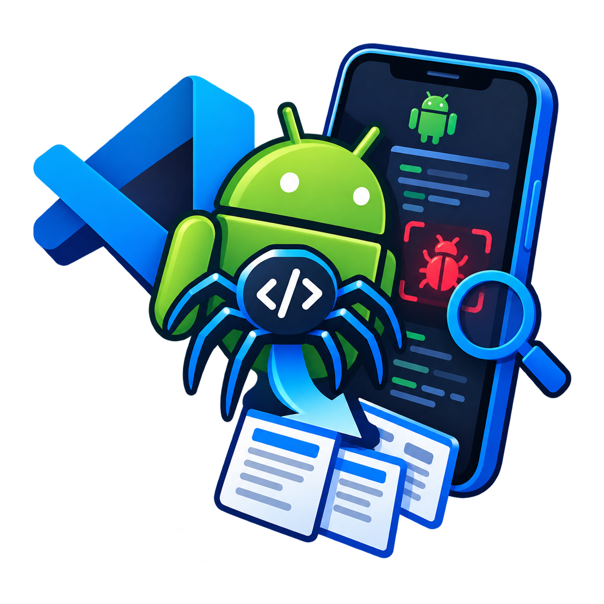

<div align="center">

# Scripy Preview



**Mirror and control your Android phone screen directly from Visual Studio Code, via USB cable or wireless (Wi-Fi).**

[](https://code.visualstudio.com/)
[](https://github.com/Genymobile/scrcpy)
[]()

</div>

---

## 📖 About the Extension

**Scripy Preview** is a VS Code extension that wraps [scrcpy](https://github.com/Genymobile/scrcpy) and ships the required binaries inside the package, so you can start using it right away without manually installing any additional tools.

---

## ✨ Key Features

- **Ready to Use**: `scrcpy` and `adb` binaries are bundled inside the extension (`model/`).
- **Automatic OS Detection**: Windows (`model/win/`), macOS (`model/mac/`), and Linux (`model/linux/`).
- **Splash Icon**: Displays a custom splash icon when the panel is opened, before `scrcpy` is launched.
- **Hassle-Free Wireless**:
  - Connect once via USB, and the extension automatically enables Wi-Fi mode and saves the device.
  - On subsequent sessions, saved devices reconnect automatically — no cable needed.
  - Android 11+ pairing (*Wireless debugging*) via the **Pair** button.
  - Manual connection by IP address using the **Add IP** button.
- **Dock Window**: The `scrcpy` window can be docked to the left, right, or float freely (*Free*).
- **Built-in Tools**: Navigation buttons (Back, Home, Recents, Power, Volume), Screenshot, Install APK, Send file, and Restart ADB.
- **Comprehensive Options**: Audio, stay awake, turn phone screen off, show touches, view only, borderless, always on top, max size, max FPS, bitrate, and recording.
- **Multi-Device Support**: Easily switch between devices using an auto-updated dropdown.
- **Persistent Settings**: All preferences and selections are remembered for the next session.

---

## 📱 Android Phone Preparation

1. Enable **Developer options** (tap *Build number* 7 times in **Settings > About phone**).
2. Enable **USB debugging**.
3. For wireless pairing mode (Android 11+), also enable **Wireless debugging**.

---

## 🚀 How to Use

### 1. Via USB (Only Once)
1. Plug your phone into the computer and grant *USB debugging* permission on the phone screen.
2. Open the **Scripy Preview** panel or click the **Device** button in the bottom-right status bar.
3. Click **Run scrcpy**.

> If the **Auto Wi-Fi when USB connected** option is enabled (default), the device will be automatically switched to Wi-Fi and saved. After that, the USB cable can be unplugged.

### 2. Wireless Mode (Wi-Fi)

| Scenario | How to Use |
| :--- | :--- |
| **Device previously connected** | Simply click **Run scrcpy**. Reconnection is automatic. |
| **Never connected before (Android 11+)** | Click **Pair**, enter the pairing `IP:PORT` and the 6-digit code from the *Wireless debugging* menu. |
| **You already know the phone's IP address** | Click **Add IP**, then enter the IP address (default port `5555`). |
| **Switching from USB to Wi-Fi** | Plug in the USB cable, then click the **USB → Wi-Fi** button. |

*Requirement:* The phone and computer must be on the same Wi-Fi network.

> *Note:* Wi-Fi mode enabled via USB (`adb tcpip`) will be lost when the phone is restarted. Simply plug in the USB cable once more, or use the **Pair** feature.

---

## 🎛️ Panel Overview

| Section | Function |
| :--- | :--- |
| **Device** | Select device, refresh, *USB → Wi-Fi*, *Pair*, *Add IP*, and *Forget*. |
| **Run / Stop** | Start or stop the `scrcpy` process. |
| **Dock Window** | Set window position (*Left*, *Free*, *Right*). |
| **Tools** | Navigation buttons, *Screenshot*, *Install APK*, *Send file*, *Open folder*, and *Restart ADB*. |
| **Options** | Advanced `scrcpy` options and wireless configuration. |
| **Log** | Real-time output from `scrcpy` and `adb`. |

---

## ⚙️ Extension Options

| Option | Description |
| :--- | :--- |
| **Auto reconnect Wi-Fi devices** | Automatically reconnects previously saved wireless devices. |
| **Auto Wi-Fi when USB connected** | Automatically switches a USB connection to Wi-Fi. |
| **Always on top** | Keeps the `scrcpy` window above all other windows. |
| **Forward audio** | Forwards phone audio to the computer (requires Android 11+). |
| **Stay awake** | Prevents the phone screen from sleeping while connected. |
| **Turn phone screen off** | Turns off the physical phone screen while mirroring continues. |
| **Show touches** | Displays touch points on the screen. |
| **View only** | Mirrors the screen without touch control. |
| **Borderless window** | Removes the window frame of `scrcpy`. |
| **Record** | Records the screen to the `~/Scripy` directory (`.mkv` format). |
| **Max size / Max FPS / Bitrate** | Limits resolution, frame rate, and video quality. |

*Changes to dock position and options will be applied on the next Run session.*

---

## 🎚️ VS Code Settings (`settings.json`)

| Setting | Default | Description |
| :--- | :--- | :--- |
| `scripyPreview.dock` | `right` | Window position: `left`, `right`, or `none` |
| `scripyPreview.alwaysOnTop` | `true` | Window stays on top |
| `scripyPreview.screenScale` | `0` | Override screen scale. `0` means automatic |

---

## ⌨️ Commands

| Command | Command ID |
| :--- | :--- |
| **Run scrcpy** | `scripy-windows-preview.run` |
| **Stop scrcpy** | `scripy-windows-preview.stop` |

---

## 📁 Output File Location

Screenshots and video recordings are automatically saved to the **`Scripy`** folder in your home directory (`~/Scripy`). You can quickly open it using the **Open folder** button.

---

## 🗂️ Project Folder Structure

```text
.
├── dist/               # Compiled script output
├── icon/               # Splash and extension icons
├── model/
│   ├── win/            # scrcpy.exe, adb.exe, DLLs, scrcpy-server
│   ├── mac/            # scrcpy, adb, scrcpy-server
│   └── linux/          # scrcpy, adb, scrcpy-server
├── src/extension.ts    # Main extension code
└── package.json
```

> **Important:** Make sure `.vscodeignore` does **not** exclude the `model/**` and `icon/**` folders, so the binaries are packaged into the `.vsix` file.

---

## 🛠️ Development

1. Install dependencies:
   ```bash
   npm install
   ```

2. Compile to the `dist/` directory:
   ```bash
   npm run compile
   ```

3. Press **F5** in VS Code to open an *Extension Development Host* window.

### Building the Install Package (.vsix)

```bash
npx vsce package
code --install-extension scripy-windows-preview-<version>.vsix
```

---

## 🔍 Troubleshooting

| Issue | Solution |
| :--- | :--- |
| `No Android device detected` | Check the USB cable, enable *USB debugging*, or use the **Pair** / **Add IP** feature. |
| `unauthorized` | Unlock the phone screen and approve the *USB debugging* dialog. |
| `offline` | Unplug and replug the USB cable, or disable and re-enable *USB debugging*. |
| Wi-Fi connection failed | Ensure the phone and computer are on the same Wi-Fi network and that the firewall is not blocking `adb`. |
| Wireless connection lost after phone restart | Plug in the USB cable once more, or re-pair the device. |
| `scrcpy not found` | Make sure the `model/` folder is packaged (check your `.vscodeignore` configuration). |
| Buttons not responding / ADB frozen | Click the **Restart ADB** button on the panel. |
| Dock position misaligned on HiDPI displays | Manually adjust the `scripyPreview.screenScale` setting in VS Code. |
| No audio | The audio feature requires Android 11+. Make sure *Forward audio* is enabled. |
| macOS / Linux: *permission denied* | The extension grants execution permissions automatically. If it still fails, run `chmod +x` on the files inside the `model/<os>/` folder. |

---

## 👥 Credits & Developer

- **Developer:** **dwi bakti n dev**
- Built on top of [scrcpy](https://github.com/Genymobile/scrcpy) by **Genymobile** (Apache 2.0 license) and **Android Debug Bridge (adb)**.
